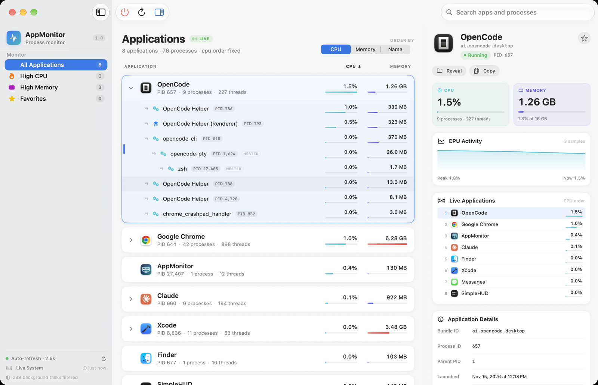
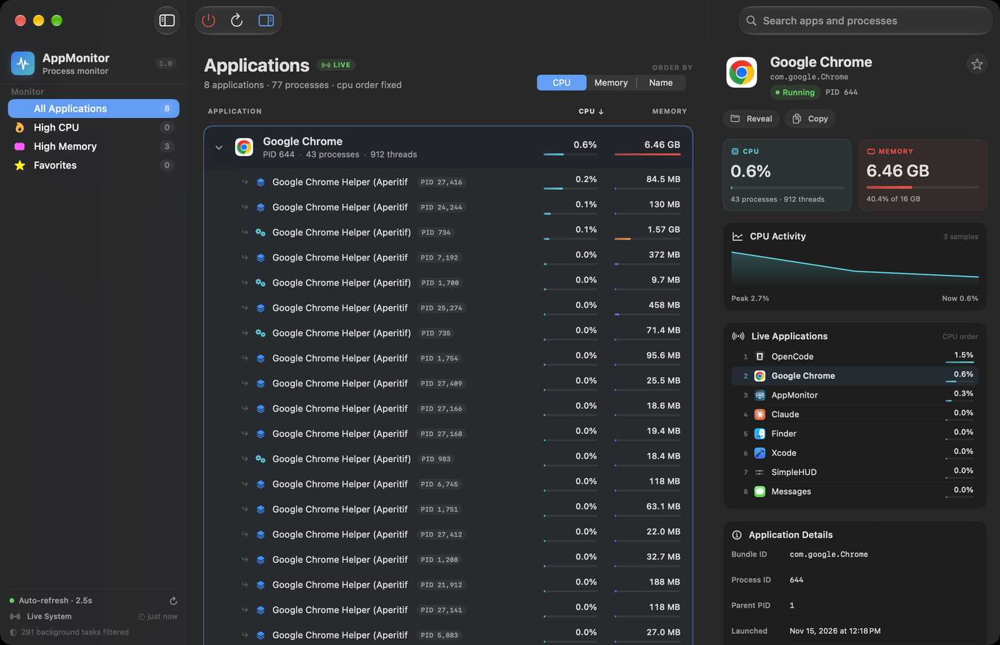

# AppMonitor

A focused, native macOS process monitor built with SwiftUI. AppMonitor orders the applications that are actually affecting your Mac by CPU impact at launch, groups every helper, renderer, and worker under its parent app, and hides the standalone daemons that make Activity Monitor feel overwhelming.

It samples this Mac's live process table through public libproc APIs — no root access, private frameworks, or special entitlements required.

**[Download AppMonitor 1.0](https://github.com/OfflinePigeon/AppMonitor/releases/latest)**

| Light | Dark |
| :---: | :---: |
|  |  |

## Highlights

- **Application-first hierarchy.** Chrome renderers, Xcode build workers, WebKit content processes, and Electron helpers are nested beneath the app they belong to instead of flooding the list.
- **Stable ranking.** Applications are ordered once by CPU when the window opens and then stay put, so a row never moves while you are reading it. Re-rank manually with CPU, Memory, or Name whenever you want.
- **Live where it belongs.** The inspector's Live Applications card reorders continuously by current CPU while the main list keeps its positions.
- **Instant drill-down.** Disclosure arrows reveal each child process, its PID, role, CPU, memory, and nested depth.
- **Smart filters.** All Applications, High CPU (≥10% of one core), High Memory (≥1 GB), and starred Favorites.
- **Search anything.** Match an application, bundle identifier, executable path, helper name, or PID; the owning app stays in the results and shows how many children matched.
- **Purpose-built inspector.** Aggregate metric cards, a live CPU sparkline, live application ranking, bundle metadata, and copy/reveal actions.
- **Honest filtering.** Standalone launch agents and daemons stay out of the list, while the sidebar reports exactly how many background tasks were filtered.
- **Live from launch.** A short CPU warm-up makes the first frame meaningful, then values refresh every 2.5 seconds; the header's green LIVE badge and sidebar footer confirm the source.
- **Preview-safe fixtures.** Every SwiftUI preview and unit test uses deterministic mock data. The shipping app never renders it.

## Download

The signed, universal build is attached to the **[latest GitHub release](https://github.com/OfflinePigeon/AppMonitor/releases/latest)** as `AppMonitor.zip`.

1. Download and unzip `AppMonitor.zip`.
2. Move `AppMonitor.app` into `/Applications`.
3. Open it. The build is ad-hoc signed, so if Gatekeeper warns on first launch, right-click the app and choose **Open** once.

Requires macOS 14 Sonoma or later.

## Requirements

- macOS 14 Sonoma or later
- Xcode 15 or later (the included project was generated with Xcode 27)
- [XcodeGen](https://github.com/yonaskolb/XcodeGen) 2.46 or later — only needed if you regenerate the project
- No root privileges, signing certificate, or app entitlements are required for local development

## Getting started

```bash
cd AppMonitor
xcodegen generate        # optional; the generated project is already included
open AppMonitor.xcodeproj
```

Select the **AppMonitor** scheme and **My Mac**, then press **⌘R**. The app launches directly into live monitoring and lists the applications currently running on your Mac.

To build and test from the command line:

```bash
xcodebuild -project AppMonitor.xcodeproj -scheme AppMonitor \
  -configuration Debug -destination 'platform=macOS' build

xcodebuild -project AppMonitor.xcodeproj -scheme AppMonitor \
  -configuration Debug -destination 'platform=macOS' test
```

Regenerate the Xcode project after adding or removing source files, or after editing `project.yml`:

```bash
xcodegen generate
```

## Using AppMonitor

### Live detection

AppMonitor samples the current process table from launch using `NSWorkspace` and libproc. A short bridging sample establishes a CPU baseline before the first window appears, so the initial list is already ordered by real CPU usage. Applications and their helper processes are grouped automatically, and later refreshes update metrics without moving the main rows.

There is no simulated mode in the shipping app. The sidebar footer shows **Live System** and the header carries a green **LIVE** badge. Only user-facing applications become root rows; menu bar agents and standalone daemons are excluded and counted at the bottom of the sidebar.

### Working with the list

- **Expand** an app with its chevron (or the context menu) to see its process tree. Nested workers are indented and marked `NESTED`; every child has its own metrics.
- **Re-rank** with the segmented CPU / Memory / Name control, or click the `APPLICATION`, `CPU`, or `MEMORY` column headers. Each choice re-orders the list once and then freezes it again; automatic refreshes never move rows.
- **Filter** from the sidebar. Counts always describe the whole data set, not the current search.
- **Search** from the toolbar field. Searching a helper such as `swift-frontend` keeps Xcode as the parent result and adds a matching-process count.
- **Select** an app to populate the inspector. Use the star button to pin it to Favorites. The Live Applications card below the metrics always shows every app in current CPU order and can be clicked to change the selection.
- **Right-click** a row for favorite, Reveal in Finder, Copy Process Summary, and Copy PID.
- **Quit the selected application** with the red power button in the toolbar. It asks the app to quit gracefully, so unsaved-work prompts still appear. Use ⌘Q to quit AppMonitor itself.

### What the numbers mean

| Metric | Definition |
| --- | --- |
| **CPU** | Share of one logical core, normalized like Activity Monitor: `100%` means one full core and multi-threaded apps can exceed `100%`. Live values are derived from the change in cumulative `ri_user_time + ri_system_time` over wall-clock time. |
| **Memory** | Sum of each process's physical footprint (`ri_phys_footprint` in live mode), matching the modern Activity Monitor memory column. |
| **Threads** | Sum of thread counts across the application tree, useful for spotting runaway helpers. |
| **Processes** | The app root plus every descendant attached by parent PID or bundle containment. |

Background-filtered totals combine processes a provider could not inspect with standalone agents that were successfully read but intentionally excluded. The number is always shown in the sidebar so filtering never feels like data loss.

### Keyboard shortcuts

| Shortcut | Action |
| --- | --- |
| ⌘R | Refresh now |
| ⌥⌘I | Show or hide the inspector |
| ⌘Q | Quit AppMonitor |
| Toolbar power button | Quit the selected application |

## Architecture

AppMonitor uses a small, testable MVVM stack. Views only render groups exposed by the view model and never inspect libproc directly.

```
NSWorkspace + libproc
          │
          ▼
LiveProcessDataProvider
          │  ProcessDataProviding
          ▼
ProcessSnapshot (flat, immutable)
          │
          ▼
ProcessTreeBuilder
          │  PPID tree + bundle adoption
          ▼
[ApplicationGroup] (aggregate metrics)
          │
          ▼
AppMonitorViewModel
filter → search → frozen order → history
          │
          ▼
SidebarView · MonitorListView · ProcessDetailView
```

`MockProcessDataProvider` conforms to the same protocol so previews and tests can render deterministic fixtures. It is not part of the shipping data path.

### Data flow

1. A `ProcessDataProviding` implementation returns an immutable `ProcessSnapshot`.
2. `ProcessTreeBuilder` converts the flat process table into `ApplicationGroup` values and computes aggregate metrics exactly once.
3. `AppMonitorViewModel` owns filters, the frozen main order, search, expansion, favorites, and history. Its `visibleGroups` property is the single list the UI renders; `liveCPUOrderedGroups` feeds the inspector's updating ranking.
4. SwiftUI views forward intent (select, expand, star, refresh) back to the view model.

### Process grouping algorithm

Grouping is deliberately independent of the provider, so it is fully testable with mock fixtures:

1. **PPID tree.** Every app root is matched with its real descendants by walking parent PIDs. This captures helpers, renderers, XPC children, and nested workers such as `swift-frontend` beneath `XCBBuildService`.
2. **Bundle adoption.** Some helpers are re-parented to `launchd` by macOS. A still-unclaimed process is adopted only when its executable lives inside the app's bundle; the longest matching bundle path wins. This keeps Chrome helpers and XPC services attached without pulling in unrelated agents.
3. **Exclusion.** Anything left over is treated as a standalone background process and excluded. Contained orphans are not claimed twice, cycles are prevented with visited sets, duplicate PIDs are de-duplicated, and nested depth is preserved.

The algorithm is covered by tests for aggregation, adoption, nested depth, duplicate PIDs, and inclusion/exclusion accounting.

## Live detection

`LiveProcessDataProvider` is the shipping bridge in [`AppMonitor/Services/LiveProcessDataProvider.swift`](AppMonitor/Services/LiveProcessDataProvider.swift). It uses only public APIs:

| API | Purpose |
| --- | --- |
| `NSWorkspace.shared.runningApplications` | Find regular, Dock-visible app roots and their localized names, bundle IDs, and bundle URLs. |
| `proc_listpids(PROC_ALL_PIDS)` | Enumerate the process table. |
| `proc_pidpath`, `proc_name` | Resolve executable paths and raw process names. |
| `proc_pidinfo(PROC_PIDTBSDINFO)` | Read parent PID, UID, and start time. |
| `proc_pidinfo(PROC_PIDTASKINFO)` | Read thread count and a resident-memory fallback. |
| `proc_pid_rusage(RUSAGE_INFO_V4)` | Read cumulative CPU time and physical footprint. |

PIDs that cannot be inspected — for example, other users' processes or entitlement-protected system processes — are skipped individually. One inaccessible process never causes the whole refresh to fail. Helper roles are classified as renderer, helper, or service for presentation.

### Replacing the live provider

The only contract is:

```swift
protocol ProcessDataProviding: Sendable {
    func fetchSnapshot() async throws -> ProcessSnapshot
}
```

To connect a different backend (sysctl, EndpointSecurity, a privileged helper, or a remote service):

1. Implement `ProcessDataProviding`.
2. Return one `MonitoredProcess` per process. Set `isApplicationRoot` for user-facing apps, provide `parentPID` and optional bundle paths, and fill in `ResourceMetrics`.
3. Keep `ProcessTreeBuilder` in the pipeline — it owns grouping and filtering.
4. Pass your provider into `AppMonitorViewModel(provider:)` or replace the default.

Mock data remains injectable for tests and previews; the shipping app always uses the live provider.

### Sandboxing and distribution

The project sets `ENABLE_APP_SANDBOX = NO` because libproc cannot inspect other processes inside the App Sandbox. This is fine for a local, developer-signed utility.

For Mac App Store distribution, keep the SwiftUI UI sandboxed and move process sampling into a privileged XPC helper or a separately installed launch daemon. Your helper should use the narrowest possible interface, validate callers, and expose only the metadata the UI actually needs. Without such a helper, a sandboxed build should ship a reduced feature set.

## SwiftUI previews

Every preview uses `MockProcessDataProvider` and a seeded history — previews never sample the live system and never require entitlements.

Open any of these files in Xcode and use **Editor → Canvas**:

- `ContentView.swift` — full light and dark windows, plus a High Memory variant
- `SidebarView.swift` — smart filters and live status footer
- `MonitorListView.swift` — ordered application list
- `ApplicationGroupRow.swift` — expanded Chrome hierarchy
- `ProcessDetailView.swift` — inspector in light and dark

The reusable icon, bar, pill, and sparkline components are exercised throughout those previews.

`AppMonitorViewModel.preview()` is the shared factory for deterministic preview state.

## Tests

The test target contains **19 passing tests** covering the behavior that matters most:

- CPU, memory, and alphabetical re-ranking
- Frozen main-list order while live CPU updates continue
- High CPU, High Memory, and Favorites filtering
- Search by app, helper process, and PID
- Initial expansion of the busiest app that has children
- Preview history seeding and filtered-count accounting
- PPID grouping, bundle adoption of orphaned helpers, nested worker depth
- Metric aggregation, duplicate PIDs, and inclusion/exclusion invariants

Run them with the command in [Getting started](#getting-started), or press **⌘U** in Xcode. The scheme gathers coverage data automatically.

## Project layout

```
AppMonitor/
├── App/
│   ├── AppMonitorApp.swift          # App entry, window, menus, shortcuts
│   └── SnapshotSupport.swift        # DEBUG-only self-snapshot utility
├── Models/
│   ├── MonitoredProcess.swift       # Normalized process + role
│   ├── ApplicationGroup.swift       # App tree, aggregated metrics, search
│   ├── ProcessSnapshot.swift        # One immutable collection pass
│   ├── ResourceMetrics.swift        # CPU / memory / threads + addition
│   └── MonitorFiltering.swift       # Sort keys and smart filters
├── Services/
│   ├── ProcessDataProviding.swift   # Provider seam + typed errors
│   ├── MockProcessDataProvider.swift# Deterministic preview/test fixture
│   ├── LiveProcessDataProvider.swift# NSWorkspace + libproc bridge
│   └── ProcessTreeBuilder.swift     # PPID grouping + bundle adoption
├── ViewModels/
│   └── AppMonitorViewModel.swift    # State, ranking, history, favorites
├── Views/
│   ├── Root/ContentView.swift       # Three-pane shell and toolbar
│   ├── Sidebar/SidebarView.swift    # Filters and live status footer
│   ├── List/                        # Header, cards, expandable process rows
│   ├── Detail/ProcessDetailView.swift
│   └── Components/                  # Icons, metric bars, sparklines, pills
├── Utilities/MetricFormatter.swift  # Formatting, palette, layout constants
└── Resources/
    ├── AppIcon.icns                 # Finder icon referenced by Info.plist
    └── Assets.xcassets              # App icon set and accent color

AppMonitorTests/                     # 19 unit tests
Support/AppMonitor-Info.plist        # Bundle metadata and icon keys
Scripts/generate_app_icon.swift      # Regenerates the icon set and .icns
project.yml                          # XcodeGen source of truth
docs/                                # README screenshots and release notes
dist/                                # Local release artifacts (ignored by git)
```

## Developer utilities

### Self-snapshots

`SnapshotSupport` is compiled only in Debug. It lets the app capture its own window, which is useful for visual checks and CI artifacts when screen-recording permission is unavailable:

```bash
APPMONITOR_SNAPSHOT_PATH=/tmp/appmonitor.png \
APPMONITOR_SNAPSHOT_APPEARANCE=dark \
  /path/to/AppMonitor.app/Contents/MacOS/AppMonitor
```

Launch the binary directly (not through `open`) so the environment variables are inherited. The app waits for layout, writes the PNG, and exits. Omit `APPMONITOR_SNAPSHOT_APPEARANCE` to use the system appearance.

### App icon

The icon is generated programmatically with AppKit, so it can be regenerated without external design tools:

```bash
swift Scripts/generate_app_icon.swift
```

This writes all required sizes into `AppMonitor/Resources/Assets.xcassets/AppIcon.appiconset` and rebuilds `AppMonitor/Resources/AppIcon.icns` for Finder and the downloaded bundle. The mark is a simple power symbol on a navy-to-teal tile.

## Design notes and limitations

- **Scope by design.** AppMonitor focuses on CPU and memory for user-facing apps. It intentionally omits disk, network, energy, GPU, and fan metrics, as well as process termination.
- **Regular apps only.** Menu bar extras and background agents are not app roots. This is what keeps the list calm, and the filtered count makes the trade-off visible.
- **First live sample.** A CPU percentage requires two rusage samples, so the provider takes a 1-second bridging sample before the first window appears. The initial order already reflects real usage; later refreshes use the normal 2.5-second cadence.
- **Sampling cadence.** Live mode refreshes every 2.5 seconds. A preference surface would be the next step for a longer-lived deployment.
- **Persistence.** Only favorites are persisted, in `UserDefaults`. Filter and sort reset on launch; snapshots and history live in memory.
- **Permissions.** Processes owned by other users may be invisible or partially inspectable depending on system policy. They are skipped rather than shown as errors.
- **No network.** There are no analytics, telemetry, or outbound network calls.

---

Built with SwiftUI and AppKit. Copyright © 2026 Nivaan.
